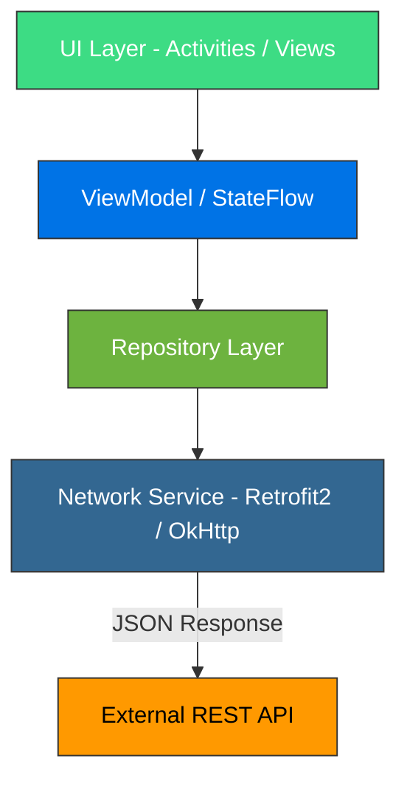

# 📕 Wikimon – Enciclopedia Interactiva Móvil

**Wikimon** es una aplicación móvil nativa desarrollada para Android, diseñada para la consulta interactiva de criaturas e información enciclopédica. El proyecto se centra en ofrecer un rendimiento de lectura fluido, integración con APIs externas y una experiencia de usuario reactiva mediante la gestión asíncrona de datos.

---

## 🎯 Propósito del Proyecto

El objetivo principal de Wikimon es demostrar el dominio en el consumo de servicios web externos y la optimización de recursos en dispositivos móviles:

- **Consumo eficiente de APIs:** conexión asíncrona con endpoints REST sin bloquear la interfaz de usuario.
- **Filtrado en tiempo real:** algoritmos de búsqueda instantánea y filtrado dinámico sobre grandes colecciones de datos.
- **Gestión de estados de UI:** control del ciclo de vida y manejo de estados de carga, éxito y error para conseguir una navegación fluida.

---

## 📐 Arquitectura del Sistema

El proyecto sigue una arquitectura por capas basada en el patrón **Repository**, desacoplando la capa de red de la interfaz mediante **ViewModel** y **Kotlin Coroutines**.

---

## 💻 Implementación Técnica

### 🛠️ Capa de Red y Datos (Network Layer)

- **Retrofit 2 y OkHttp:** configuración del cliente HTTP para la serialización y el procesamiento de respuestas JSON.
- **Kotlin Coroutines:** ejecución de operaciones asíncronas mediante `Dispatchers.IO` para evitar bloquear el hilo principal (`Main Thread`).
- **Caché y carga de imágenes:** integración de librerías como Coil o Glide para optimizar el uso de memoria RAM y datos móviles.

### 🎨 Interfaz de Usuario (UI Layer)

- **Componentes reactivos:** uso de `RecyclerView` con adaptadores optimizados mediante `DiffUtil` para renderizar listas de elementos de forma eficiente.
- **Búsqueda dinámica:** filtrado en tiempo real por nombre, tipo o atributos.
- **Material Design:** componentes visuales orientados a mantener una interfaz consistente y una experiencia de usuario intuitiva.

---

## 🛠️ Stack Tecnológico

| Categoría | Herramientas / Tecnologías |
|---|---|
| Lenguaje | Kotlin |
| Networking | Retrofit 2, OkHttp, Gson |
| Asincronía | Kotlin Coroutines |
| UI Framework | Android SDK, Material Design, ViewBinding |
| Carga de imágenes | Coil / Glide |
| Arquitectura | MVVM / Repository Pattern |
| Herramientas | Android Studio, Git / GitHub |

---

## 👤 Contacto

  

  

  
